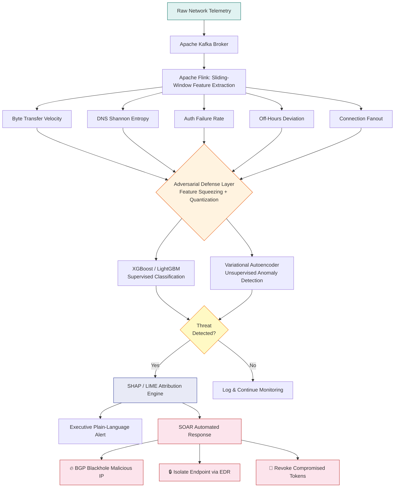
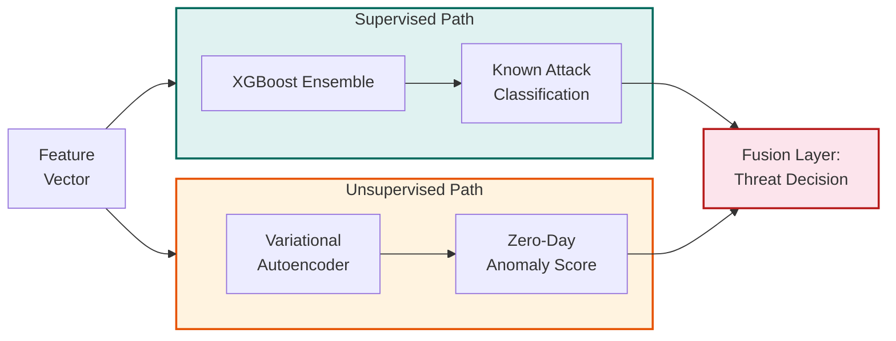
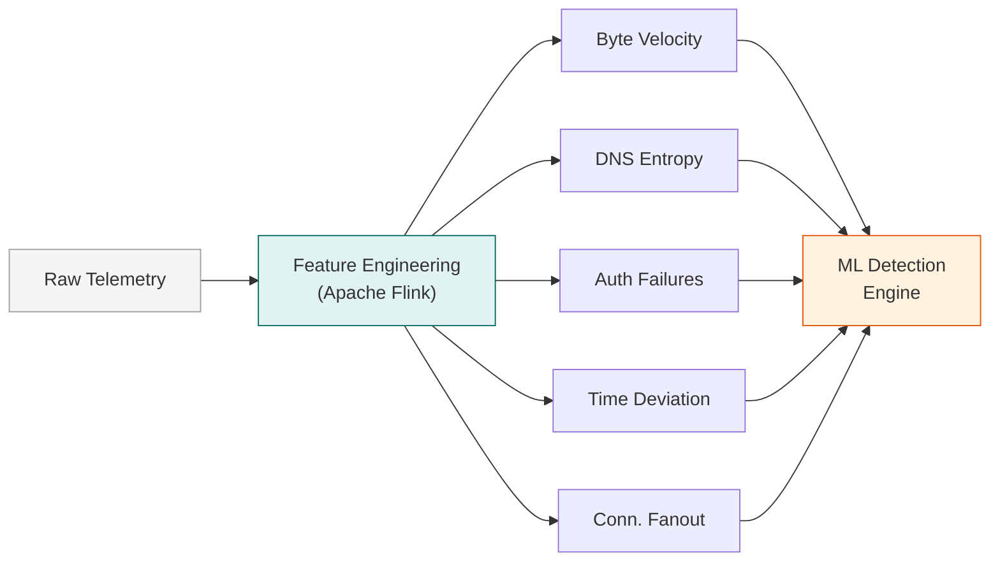
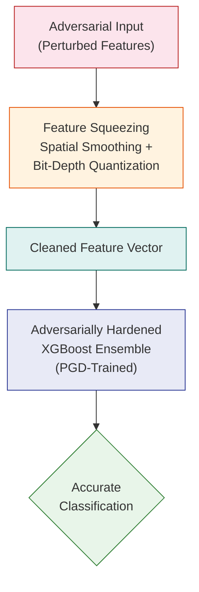
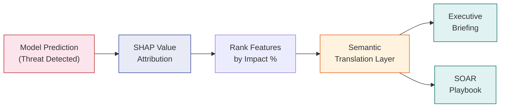
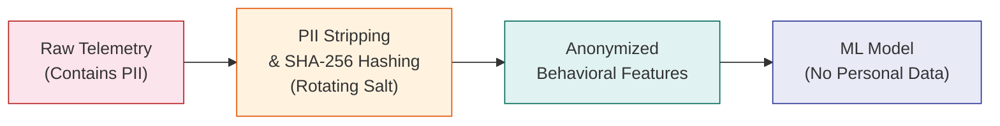

<div align="center">


# AI-Based Threat Detection & Prevention System
#### *Enterprise Infrastructure Security — Autonomous Real-Time Defense Platform*

<br/>

[](code/threat_detector_xai.py)&nbsp;&nbsp;[](code/threat_detector_xai.py)&nbsp;&nbsp;[](generate_cybersecurity_pdf.py)&nbsp;&nbsp;[-6A1B9A?style=flat-square&logo=gnuprivacyguard&logoColor=white)](docs/deliverables/AI_Cybersecurity_Threat_Detection_Report.pdf)

<br/>

**Autonomous, real-time AI threat detection and prevention platform** for mid-sized enterprise infrastructure.  
Integrates streaming telemetry ingestion, hybrid ML/DL anomaly detection, adversarial defense,  
and plain-language Explainable AI (XAI) alert generation with automated SOAR response.

<br/>

---

<br/>

<table>
<tr>
<td align="center" width="160"><b>👤 Candidate</b></td>
<td align="center" width="160"><b>🎓 Roll Number</b></td>
<td align="center" width="220"><b>📧 Email</b></td>
<td align="center" width="160"><b>🔬 Domain</b></td>
</tr>
<tr>
<td align="center"><b>Garvit Sharma</b></td>
<td align="center">2301730190</td>
<td align="center"><a href="mailto:garvitsharma8909@gmail.com">garvitsharma8909@gmail.com</a></td>
<td align="center">AI in Cybersecurity</td>
</tr>
</table>

<br/>

📄 **Primary Deliverable:** [AI_Cybersecurity_Threat_Detection_Report.pdf](docs/deliverables/AI_Cybersecurity_Threat_Detection_Report.pdf)

<br/>

</div>

---

## Table of Contents

- [System Architecture](#-system-architecture)
- [Detection Pipeline Flow](#-detection-pipeline-flow)
- [Attack Identification & ML Strategy](#1-attack-type-identification--ml-detection-strategy)
- [Feature Engineering](#2-feature-engineering--justification)
- [Adversarial Defense](#3-adversarial-attack-vulnerability--mitigation)
- [Explainable AI Demo](#4-explainable-ai-xai-for-non-technical-stakeholders)
- [Ethics & Privacy](#5-ethical--privacy-governance)
- [Repository Structure](#-repository-structure)
- [Getting Started](#-getting-started)

---

## 🏗 System Architecture

> High-level overview of the five-tier autonomous defense platform.

```mermaid
graph LR
    subgraph INGEST["① Ingestion"]
        direction TB
        K["Apache Kafka<br/>50K events/sec"]
    end

    subgraph FEAT["② Feature Engineering"]
        direction TB
        FL["Apache Flink<br/>Sliding-Window Extractor"]
    end

    subgraph DETECT["③ Hybrid Detection"]
        direction TB
        XG["XGBoost<br/>Known Attacks"]
        AE["Deep Autoencoder<br/>Zero-Day Discovery"]
    end

    subgraph XAI["④ XAI Alerting"]
        direction TB
        SH["SHAP Engine<br/>Plain-English Narratives"]
    end

    subgraph SOAR["⑤ SOAR Response"]
        direction TB
        SR["Automated<br/>Containment"]
    end

    INGEST --> FEAT --> DETECT --> XAI --> SOAR

    style INGEST fill:#E0F2F1,stroke:#00695C,stroke-width:2px
    style FEAT fill:#E0F2F1,stroke:#00695C,stroke-width:2px
    style DETECT fill:#FFF3E0,stroke:#E65100,stroke-width:2px
    style XAI fill:#E8EAF6,stroke:#283593,stroke-width:2px
    style SOAR fill:#FCE4EC,stroke:#B71C1C,stroke-width:2px
```



### Data Sources Ingested

| Source | Protocol | Volume |
|:---|:---|:---|
| Network Traffic Flows | NetFlow / IPFIX | ~30K flows/sec |
| DNS & TLS Metadata | Zeek Sensor | ~10K queries/sec |
| Endpoint Telemetry | Windows Sysmon + EDR | ~8K events/sec |
| Cloud Audit Logs | AWS CloudTrail | ~2K events/sec |

---

## 🔄 Detection Pipeline Flow

> Detailed flow from raw telemetry to automated containment.



---

## 🎯 Capstone Problem Statement & Solutions

### 1. Attack Type Identification & ML Detection Strategy

**Primary Attack Type:** Distributed Polymorphic Ransomware & Automated Multi-Stage Data Exfiltration

```
Lateral Movement  →  Internal Staging  →  Data Egress  →  Encryption Trigger
```

**Proposed AI/ML Strategy — Dual-Path Hybrid Inference:**



| Path | Model | Training Data | Strength |
|:---|:---|:---|:---|
| **Supervised** | XGBoost / LightGBM | CIC-IDS2017 + Enterprise Logs | Sub-millisecond detection of known signatures |
| **Unsupervised** | Variational Autoencoder (VAE) | Benign baseline flows only | Zero-day discovery via reconstruction loss threshold |

> Anomalies flagged when VAE reconstruction loss exceeds the dynamic 99.5th percentile threshold.

---

### 2. Feature Engineering & Justification

| Feature | Formulation | Why It Matters |
|:---|:---|:---|
| **Byte Transfer Velocity** | `Bytes / ΔTime` | Separates normal browsing from bulk exfiltration spikes |
| **DNS Shannon Entropy** | `-Σ pᵢ log₂(pᵢ)` | Catches algorithmically generated domains (DGA) and DNS tunneling |
| **Auth Failure Rate** | `Count in 60s window` | Exposes credential stuffing and brute-force password spraying |
| **Off-Hours Activity Score** | `\|t_access - μ_historical\|` | Identifies stolen credentials used outside business hours |
| **Connection Fanout** | `Distinct Dest IPs / 5 min` | Captures automated port scanning and worm lateral propagation |



---

### 3. Adversarial Attack Vulnerability & Mitigation

**Threat:** Evasion Attacks via Gradient Perturbation (FGSM / PGD)

> Adversaries inject non-functional packet padding and fragment flow durations to dilute byte velocity, pushing the feature vector across the decision boundary into the benign region.

**Defense Strategy:**



| Defense Layer | Technique | Effect |
|:---|:---|:---|
| **Pre-Inference** | Feature Squeezing & Quantization | Strips subtle noise perturbations from input vectors |
| **Training-Time** | PGD Adversarial Training | Model learns decision boundaries robust to gradient attacks |

---

### 4. Explainable AI (XAI) for Non-Technical Stakeholders

The platform embeds a **Semantic Translation Layer** that converts SHAP/LIME attribution values into actionable executive briefings:

```
┌─────────────────────────────────────────────────────────────────────────┐
│  🛡️  AI SECURITY INCIDENT EXPLANATION (EXECUTIVE SUMMARY)             │
│─────────────────────────────────────────────────────────────────────────│
│  ALERT LEVEL: 🔴 HIGH RISK CRITICAL INCIDENT (Confidence: 99.8%)      │
│                                                                         │
│  WHAT HAPPENED?                                                         │
│  Anomalous outbound transmission detected from Workstation 10.0.14.88  │
│  to external server 198.51.100.24.                                     │
│                                                                         │
│  WHY DID THE AI TRIGGER THIS ALERT?                                    │
│  ├── 90.0%  Unusually Fast Data Transfer Speed (Exfiltration Spike)    │
│  ├──  5.3%  Repeated Failed Logins (7 brute-force attempts)            │
│  ├──  3.5%  Connection to Untrusted External Server                    │
│  └──  1.2%  Abnormally High Sensitive Data Volume                      │
│                                                                         │
│  AUTOMATED ACTIONS TAKEN:                                               │
│  ✅ Workstation 10.0.14.88 quarantined from local network              │
│  ✅ Outbound IP 198.51.100.24 blacklisted at perimeter firewall        │
│  ✅ Containment completed in 0.24 seconds — no data loss confirmed     │
└─────────────────────────────────────────────────────────────────────────┘
```



---

### 5. Ethical & Privacy Governance

**The Dilemma:** Continuous deep telemetry monitoring (keystrokes, working hours, web endpoints) borders on invasive surveillance, violating employee trust and international privacy laws (GDPR Article 88).

**Mitigation — Differential Privacy with Ingestion-Layer Pseudonymization:**



| Concern | Mitigation | Compliance |
|:---|:---|:---|
| Employee PII exposure | SHA-256 pseudonymization with rotating salt | GDPR Art. 88 |
| Payload content inspection | Content stripped before feature extraction | Data minimization |
| Model memorization risk | Differential privacy noise injection | GDPR Art. 25 |

---

## 📁 Repository Structure

```
AI_Cybersecurity_Capstone/
│
├── code/
│   └── threat_detector_xai.py           # AI detection engine + XAI narrative generator
│
├── docs/
│   └── deliverables/
│       └── AI_Cybersecurity_Threat_Detection_Report.pdf   # Executive PDF report
│
├── generate_cybersecurity_pdf.py         # ReportLab PDF compiler script
└── README.md                             # Project documentation (this file)
```

---

## 🚀 Getting Started

### Prerequisites

```bash
pip install reportlab
```

### Run the AI Threat Detection & XAI Engine

```bash
cd code
python threat_detector_xai.py
```

**Expected Output:** A complete XAI executive briefing showing threat detection results with SHAP-based plain-language explanations.

### Generate the Submission Report PDF

```bash
python generate_cybersecurity_pdf.py
```

**Output:** `docs/deliverables/AI_Cybersecurity_Threat_Detection_Report.pdf`

---

<div align="center">

---

&nbsp;&nbsp;

*Confidential Enterprise Threat Detection System*

</div>
